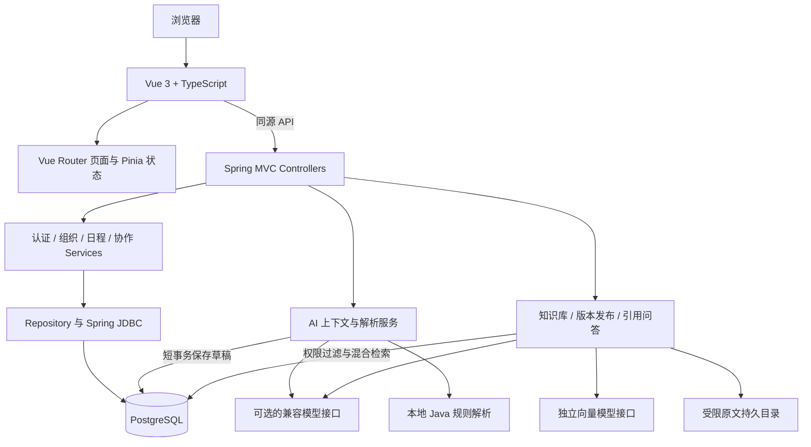

# 当前企业版架构

采用独立 Vue 前端、Spring Boot 模块化 API 服务和 PostgreSQL 数据库。后端按业务领域拆分，作为一个 Java 服务部署。适用于当前规模的企业管理系统；后续可根据业务和负载拆分服务，当前没有引入服务间网络调用。

## 前端

页面由真实 Vue 组件渲染，通过 Vue Router 分页、按页面加载代码。API 客户端统一处理超时和错误，TypeScript 定义用户、团队、日程、通知和冲突的字段。Pinia 保存当前账号、共享数据及页面会话中的 AI 草稿。接口 Cookie 随同源请求发送，浏览器不保存密码或模型密钥。

开发时 Vite 代理 `/api` 至 Java 服务；构建后可由 Nginx 分发前端资源并代理 API。AI 对话 ID 与账号关联暂存于 sessionStorage，草稿及对话记录在服务器恢复；聊天输入及未提交的手工修改刷新后可能丢失。解析期间禁用草稿编辑，防止晚到的响应覆盖输入。同步采用约15秒轮询；编辑日程时暂停后台同步以避免覆盖输入。通知总数独立查询，列表当前最多返回最近200条。

## 后端职责

| 模块 | 职责 |
| --- | --- |
| `knowledge` | PDF/Word/文本解析，持久入库任务，知识库权限与版本，关键词/向量融合检索，带引用问答与建议 |
| `api` | 明确的路由、请求来源防护、统一错误与请求编号 |
| `auth` | 会话、密码、邀请、动态团队权限 |
| `organization` | 成员、团队、负责人、会议室维护 |
| `schedule` | 日程仓储、冲突与缓冲、版本及幂等、清单、改期、执行 |
| `ai` | 授权上下文、中文规则、模型调用、字段规范化与草稿 |
| `collaboration` | 页面授权数据、通知、忙闲、历史指标 |
| `data` | JDBC 参数绑定、数据库记录映射、日志及站内通知写入 |
| `migration` | 只读旧 SQLite 导入，禁止覆盖已初始化的目标数据库 |

当前保留兼容的 `/api` 路径与核心字段。复杂日程扩展和兼容接口使用结构化 Map 与 JSONB；尚未将全部请求替换为专门 DTO，也没有拆出独立改期实体。

## 数据与一致性

PostgreSQL 保存用户、团队、会议室、日程、扩展、通知、历史、AI 草稿、会话、邀请、操作日志和幂等请求。Flyway 管理版本，HikariCP 管理连接池，Spring 事务保证日程、通知和历史一起提交或回滚。

时间使用 `timestamptz`，API 统一输出北京时间；版本时间保留微秒。新增 `events.room_id` 外键，会议室更名继续同步地点展示，历史文字保留。扩展清单、缓冲和改期信息使用 JSONB。

核心写入事务目前使用同一个 PostgreSQL 事务级 advisory lock，避免并发预订、组织变更与权限校验出现竞争。它允许多进程共享一致性，但会串行化核心写操作，当前未声称通过大规模并发压测；负载增加时可细化到按人员、资源有序加锁。读取和外部模型等待不持有该锁。

每次已有日程写入必须匹配 `expected_updated_at`。创建的 `request_id` 在数据库有用户范围内的唯一约束，防止重复派发。权限依据当前组织关系判断。

## 认证与 AI

知识库实现详见 [RAG 使用与部署说明](RAG_GUIDE.md)。Flyway V4 增加知识库、文档版本、片段向量、授权、任务、问答及向量配置数据。原文以私有持久文件保存，文本与向量保存于 PostgreSQL。外部向量调用与问答调用仍在数据库写事务之外；任务领取使用行锁及租约，处理结果原子提交。聊天与向量使用独立模型配置和修订号，共用服务器加密主密钥。

检索结果仅来自可访问的当前有效发布版本，问答需要管理员及该版本的模型发送许可。模型不能访问数据库或直接执行派发。建议与已确认草稿条件分开保存，“采用建议”走现有多轮解析与用户编辑流程，最终派发继续校验接收人、版本和冲突。

登录会话摘要保存于数据库，HttpOnly + SameSite Cookie 携带凭据，支持 HTTPS Secure 配置。新密码使用 PBKDF2；兼容旧 Python scrypt 摘要，旧密码成功登录后升级，不要求用户先重置。注册和管理员邀请码保持原有规则；当前没有关闭公开用户注册的选项。

AI 先在短事务中读取授权目录，释放连接再调用模型，返回后重新验证会话、角色、团队和接收人状态，并在短事务中保存草稿。模型不能直接写入日程。发送仍须人工确认并再次进行后端校验。

### 管理员模型配置与加密

`/api/admin/model-config` 提供管理员专用的读取、保存和清除接口；`/test` 测试已保存且启用的配置。`ModelConfiguration` 保存版本化的平台共享设置，并动态产生本次调用的连接快照。读取返回地址、模型名称和密钥是否存在等状态，不返回密钥。团队负责人即使发送伪造字段，也只走规则解析；模型调用前和结果写入前都会重新检查管理员身份，配置版本变化则丢弃旧响应。

`SecretBox` 使用AES-256-GCM，随机12字节nonce、128位认证标签和固定用途AAD，整体加密基础地址、模型名称及API密钥。`ai_model_settings` 仅保存密文、启用状态、修订号和维护人/时间。加密主密钥通过服务器环境变量或独立私有文件保存，默认首次使用时生成；不会保存在数据库、浏览器或源码包。缺失主密钥、错误主密钥及密文篡改均返回受控错误，不泄露原始值。凭据对象的字符串表示脱敏，审计只记录启用状态和是否替换密钥。

新配置立即生效，不需要重启。保存时使用当前修订号及事务锁避免管理员覆盖彼此修改；API密钥留空保留原值，清除或停用会覆盖旧环境变量回退。请求凭据由后端附加到Authorization头，HTTP客户端不跟随重定向，网络等待不占用数据库事务。正式部署由HTTPS保护客户端输入；加密数据库不替代传输保护。

### 多轮、上下文和排期

`ai_conversations` 保存当前草稿、已确认日期/时间/时长和修订号，`ai_turns` 保存每轮消息。解析最新消息只合并明确改变的字段，不把整段历史重新拼成一项安排。缺失日期、上下午、时长或接收人时保留空值并追问。会话按账号隔离，更新时校验修订号，旧请求返回409。`GET /api/ai/conversations/{id}` 可恢复当前对话。

授权上下文包含启用员工、团队、会议室，以及未来30天最多100项可编辑且尚未开始的安排和待处理改期标记。模型收到相同范围的上下文；现有日程与返回后的接收人、角色、版本再次验证。规则解析负责显式字段与歧义约束，模型补充标题、备注等语义。模型不能补造缺失日期和时长。

“刚才那场”优先依据当前对话草稿的已发送日程关联；没有唯一指代时要求选择原记录。修改草稿保留原日程编号和版本。确认时通过独立的 `ai_change_draft_id` 记录本次修改，不替换日程首次创建的草稿关联；原日程、草稿发送标记、通知和历史仍在同一事务中提交。

`SchedulingPlanner` 在一次有界占用快照中检查候选时间和登记会议室。硬约束为接收人可用、会议室可用/容量及 `scheduling_policy` 工作日/工作时段；准备和收尾包含在时段内，跨地点通勤加入人员间隔。组织团队其他成员忙闲为软约束，不给他们派发安排。按“延后分钟 × 优先级系数（普通/重要1，紧急3） + 换会议室20 + 团队忙碌人数 × 180”排序，返回最多三项不同时间/地点的方案并解释取舍。分数为确定性代价而非模型置信度。

默认候选间隔30分钟、向后7天，管理员可通过 `/api/scheduling-policy` 设置工作日、例外日期、间隔及范围（1–14天）。占用快照超过5000条时明确拒绝继续推荐，避免漏掉预约。只推荐原时间及之后的时段，不移动其他安排。选用方案会再检查，最终保存重新检查并发占用；候选是建议，不是预订。只有平台内日程参与忙闲判断，不推断外部日历或真实出勤状态。

## 迁移和运行边界

只读导入旧库的账号、团队、会议室、日程、清单、历史、通知、AI 草稿、幂等记录与操作日志，并保留编号。过期或进行中的旧登录会话及未使用邀请码不导入，迁移后重新登录并重新生成邀请。导入整笔回滚、记录源文件摘要，重复导入同一源文件不复制数据。目标已有用户或日程时拒绝覆盖。

当前已使用本机 PostgreSQL 验证业务与迁移，并有独立测试数据库。生产容器配置随源码提供，公网部署仍需配置域名、HTTPS、允许的 Origin、访问策略和备份监控。没有邮件短信、企业单点登录、外部日历双向同步或消息队列。

参考：[Spring Boot 系统要求](https://docs.spring.io/spring-boot/3.5/system-requirements.html)、[Vue TypeScript 文档](https://vuejs.org/guide/typescript/overview)。
